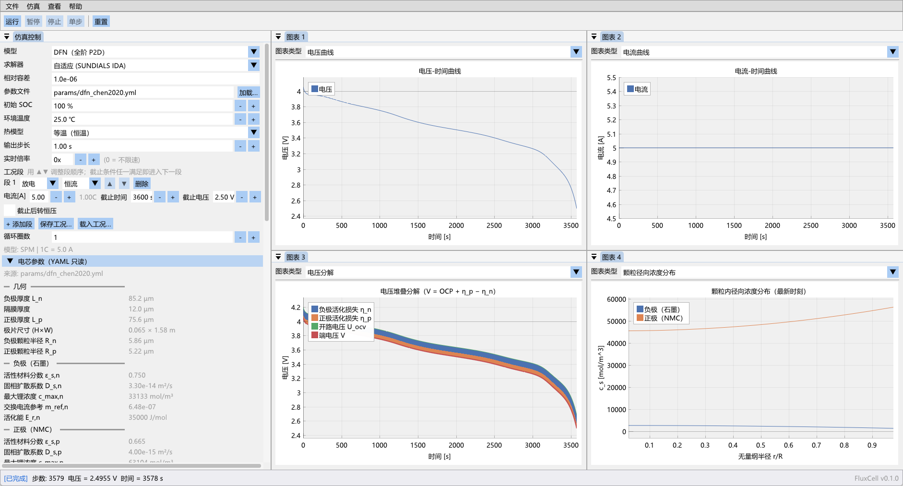

<p align="center">
  
</p>

<h1 align="center">FluxCell</h1>

<p align="center">锂离子电池电化学仿真器 — SPM / SPMe / DFN，C++20 + Dear ImGui</p>



## 功能特性

- **电化学模型**
  - SPM：单颗粒模型，电解液均匀假设
  - SPMe：扩展单颗粒模型，电解液一维传输
  - DFN / P2D：逐位置颗粒的二维固相扩散 + 液相一维传输 + 固相欧姆，反应分布由 Gummel 定点迭代求解
- **时间积分**
  - 内置 Crank–Nicolson 固定步长
  - SUNDIALS IDA 自适应步长（BDF，变阶变步长），大稀疏 DAE 系统可选用 KLU 稀疏直解
- **工况协议**
  - 多段工况：恒流 CC、恒压 CV、恒功率 CP、静置
  - 每段可按截止时间、截止电压、CV 尾电流截止
  - 段序列可整体循环 N 圈，状态跨圈连续传递，用于长循环寿命仿真
  - CV 段在 DFN 上以增广 DAE 端口电流实现（与 PyBaMM 外电路同构），其余路径回退反馈修正反解
- **热模型（DFN）**
  - 等温 / 集总热（单节点温度 ODE 双向耦合）
  - 欧姆热、反应热、可逆熵热三项产热诊断，熵变系数 dU/dT 支持外部 CSV 查找表
- **机理寿命（DFN）**
  - 负极 SEI 生长降解（OKane2022 参数集口径，随温度 Arrhenius 加速）
  - 输出累计锂损失、含降解估计容量、SEI 平均厚度
- **数据与界面**
  - Chen2020 参数集（SPM / SPMe / DFN 三套 YAML），GUI 内可读可写
  - 工况文件 YAML 往返保存（多段协议 + 循环圈数 + 模型/求解器 + 初始 SOC/环境温度）
  - 4 路可停靠实时图表，随模型类型联动（电压分解、颗粒浓度剖面、反应电流/过电位分布、温度与产热、寿命曲线等）
  - 结果 CSV 导出；核心库提供增量式 HDF5 写入器
  - 中文界面，一键 CC-CV 工况，运行/暂停/停止/单步/重置

## 构建

**前置条件**

- Windows 10/11 x64
- Visual Studio 2022（MSVC，C++20）
- CMake ≥ 3.25
- [vcpkg](https://github.com/microsoft/vcpkg)，并设置环境变量 `VCPKG_ROOT`
- Git（首次配置会通过 FetchContent 拉取 Dear ImGui / ImPlot / ImGuiFileDialog / GoogleTest）

**编译**

```powershell
git clone https://github.com/richlxx/FluxCell.git
cd FluxCell
cmake --preset windows-default
cmake --build --preset release
```

依赖由 vcpkg 管理（`eigen3`、`yaml-cpp`、`nlohmann-json`、`hdf5[zlib]`、`sundials`、`glfw3`），其中 SUNDIALS 使用仓库内的 overlay port 以启用 KLU 稀疏求解；图形依赖在配置阶段自动获取。

可执行文件输出于 `build/bin/Release/`。

## 运行

```powershell
# 在仓库根目录运行（默认参数路径 params/ 为相对路径）
build\bin\Release\FluxCell.exe
```

界面左侧为仿真控制面板：选择模型与求解器、加载参数文件、编辑多段工况后点击“运行”。默认参数为 `params/dfn_chen2020.yml`（Chen2020，LG M50 5 Ah）。

**命令行工具（SPM 恒流放电）**

```powershell
build\bin\Release\spm_cli.exe params\chen2020.yml 5.0 1.0 results\spm_1C.csv 7200 2.5
# 参数：<参数文件> <电流 A> <步长 s> <输出 CSV> [最长时长 s] [截止电压 V]
```

**打包分发**

```powershell
cmake --install build --config Release --prefix dist/FluxCell
cd build
cpack -C Release -G ZIP
```

安装目录包含可执行文件、运行时 DLL 与默认 `params/`；ZIP 便携包输出在 `build/`。

## 测试

```powershell
cmake --build build --config Debug --target fluxcell_tests
ctest --test-dir build -C Debug --output-on-failure
```

共 143 个 gtest 用例，覆盖物理模型、离散化、SPM/SPMe/DFN 模型、IDA 求解器与 YAML/工况文件读写。

## 与 PyBaMM 对标验证

`python/` 下提供基于 [uv](https://docs.astral.sh/uv/) 的验证环境，用 PyBaMM 生成基准数据并与 FluxCell 结果对比：

```powershell
cd python
uv sync
uv run python validation/generate_reference.py                      # DFN 各倍率放电基准
uv run python validation/generate_sei_cycles_reference.py --cycles 50  # SEI 长循环基准
uv run python validation/compare_results.py --fluxcell ..\results\spm_1C.csv --crate 1C
```

验证标准：电压最大绝对误差 < 10 mV、平均绝对误差 < 2 mV、容量误差 < 1%。详见 [python/README.md](python/README.md)。

## 目录结构

```
core/      模型、离散化、物理、IDA 求解器、YAML/HDF5/CSV 读写（静态库 fluxcell_core）
gui/       ImGui 界面：主窗口、仿真控制面板、实时绘图
app/       GUI 可执行程序入口
tools/     spm_cli 命令行工具
params/    Chen2020 参数集（SPM/SPMe/DFN）与熵变系数表
tests/     GoogleTest 单元与回归测试
python/    PyBaMM 基准生成与结果对比
ports/     vcpkg overlay port（SUNDIALS + KLU）
cmake/     依赖获取与第三方库构建
```

## 参考

- Chen et al., *Development of Experimental Techniques for Parameterization of Multi-scale Lithium-ion Battery Models*, J. Electrochem. Soc. 167, 080534 (2020)
- O'Kane et al., *Lithium-ion battery degradation: how to model it*, Phys. Chem. Chem. Phys. (2022)
- [PyBaMM](https://github.com/pybamm-team/PyBaMM) — 模型与参数集基准
- [SUNDIALS](https://github.com/LLNL/sundials) — IDA 微分代数方程求解器
